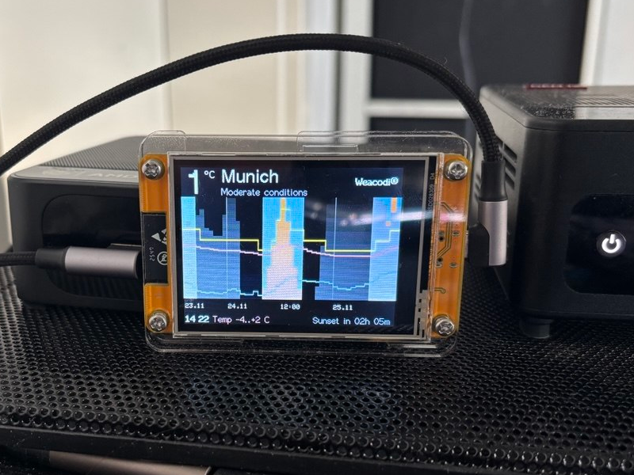

# Weacodi on ESP32

[](https://www.gnu.org/licenses/agpl-3.0)
[](https://creativecommons.org/licenses/by-sa/4.0/)
[](https://doi.org/10.5281/zenodo.18916318)

This firmware brings the **Weather Comfort Diagram™** to an ESP32 touch display. See the diagram in action on **[weacodi.com](https://weacodi.com/)**.

**To install and use the firmware**:

- Follow the [agent installation guide](#install-with-an-agent) to build and flash it with an agent that can access your board.
- Or [build and flash it manually](#install-manually-and-choose-a-city) with Arduino CLI.

The firmware provides:

- An hourly weather and cycling comfort chart.
- Touch controls to switch between one, two, and three days.
- A cached forecast that stays available during temporary network or API failures.

---



The display shows an hourly forecast chart for Munich for the next 48 hours, starting at the current local hour. Tap anywhere on the screen to cycle through 2 → 3 → 1 → 2 days. The chart switches immediately using the forecast already in memory. After a restart, the range defaults to two days. The firmware refreshes the forecast every 15 minutes.

At startup the ESP32 displays `Connecting to WiFi...`. Once connected, it changes the message to `Connecting to WiFi - connected` and keeps it visible for at least two seconds. The firmware requests the forecast as soon as the clock is synchronized, even if the message is still visible. The connection screen shows the project website, the chart authors, the CC BY-SA 4.0 license, the DOI, and contact information. The request covers five calendar days in Munich local time. The two preceding days supply data for the wet road and black ice calculations, while today and the next two days supply the chart. The chart starts at the current hour, so the three-day view shows the available hours through the end of the third calendar day.

If the network or API fails, the chart uses the last forecast stored in RAM and displays the reason for the failure. The `Cached` label appears when the logo is visible on the right. Elapsed hours are removed from the chart. After a restart, the chart appears when the board next receives a forecast.

If Wi-Fi has not been configured, the board immediately displays `Wi-Fi not configured`. If it cannot connect or synchronize its clock within 15 seconds, it displays `Wi-Fi unavailable` or `Clock sync failed`. A failed request displays `Weacodi® API unavailable` with an explanation. An empty or unusable response displays `Forecast data missing`. When the cached forecast expires, the board clears the chart and displays `Cached forecast expired`. It automatically retries after temporary failures.

The header shows the current temperature in large type on the left. The city name appears to its right, above a cycling comfort rating. When the forecast first appears or after a tap, `Next … hours` appears in the upper right for five seconds before giving way to the `Weacodi®` logo. Automatic refreshes leave this timer alone. The temperature stays visible at the bottom. After the same five seconds, a countdown to sunset or sunrise, or the label `Night time`, replaces the legend. The lower left corner shows Munich local time in antialiased digits with a blinking colon, followed by the temperature. The chart axis uses small text for dates and hours.

The chart shows day and night, sun, cloud cover, rain, and snow. The pink line shows temperature, the light blue line shows wind, and the yellow line shows cycling comfort. Rain and snow have two-pixel outlines. Rain, showers, and precipitation of unspecified type use a blue fill with a cyan outline. Snow uses a solid white fill. A three-pixel band at Y=0 marks wet roads in the color used at the bottom of the rain fill and black ice risk in white. The chart draws layers over the background in this order: rain, snow, wet roads, black ice, comfort, wind, and temperature. Precipitation and road markers stay within the 0–100 range. The wet road calculation uses current precipitation and moisture remaining from the previous 24 hours, taking drying into account. Black ice risk is marked when the road is wet and the temperature is −1 °C or below.

## Build and flash

The firmware was developed and tested on the **Elegoo ESP-32 2.8 Inch Touch LCD**, which has an ESP32-D0WD-V3, 4 MB of flash, an ILI9341 SPI display, and an XPT2046 resistive touch controller. The chart runs in landscape at 320 × 240. For a different ESP32 board, check its schematic for the display controller, pinout, and touch controller. [Tested pinout](AGENTS.md#tested-hardware)

### Install with an agent

Open the repository in an agent with access to local files and the USB port. Connect the board with a USB data cable and tell the agent its model or display controller. For example:

> Read AGENTS.md, choose the configuration for my board, and build and install Weacodi on the connected ESP32. Use my local Wi-Fi configuration and check the serial output to confirm the forecast loads.

Specify a different city if needed. Store Wi-Fi settings in the local `wifi.local.h` file, which Git ignores. [Agent instructions](AGENTS.md)

### Install manually and choose a city

1. Set up Arduino CLI, the `esp32:esp32@2.0.6` core, and the specified library versions. [Installation and build commands](AGENTS.md#build-with-arduino-cli)
2. Create `wifi.local.h` next to `esp32_weacodi.ino` and enter your 2.4 GHz network settings.

   ```cpp
   #define WIFI_SSID "your-network"
   #define WIFI_PASSWORD "your-password"
   ```

3. To change the city, edit `cityName`, the latitude, longitude, and time zone in `forecastUrl`, and the POSIX `timezone` string used by the ESP32 clock. This release sets the city in the source code. It has no city selection menu or automatic location detection. After building and flashing, the selected city persists across restarts. [Location configuration](AGENTS.md#wi-fi-and-location)
4. Build the sketch, identify the board's USB port, and flash the firmware. Open the serial monitor at 115200 baud. After Wi-Fi connects and the clock synchronizes, a normal startup logs `Forecast HTTP 200` and `Rendered 48 hours:`. [Flashing and verification commands](AGENTS.md#flash-and-verify-on-the-device)

## Licenses and attribution

| Component | License |
| --- | --- |
| Firmware source and display configuration | [GNU AGPL 3.0 only](LICENSE) |
| Weather Comfort Diagram™ (Weacodi®) concept and materials | [Creative Commons BY-SA 4.0](LICENSE_WEACODI.md) |
| Embedded Noto Sans font subsets | [SIL Open Font License 1.1](fonts/Noto-LICENSE.txt) |

Oleksii Zubovskyi and Olena Zubovska created the concept. See [NOTICE](NOTICE) for attribution, component origins, and trademark information. Citation details are available in [CITATION.cff](CITATION.cff).

[Weacodi website](https://weacodi.com/) · [Preprint](https://doi.org/10.5281/zenodo.18916318)
